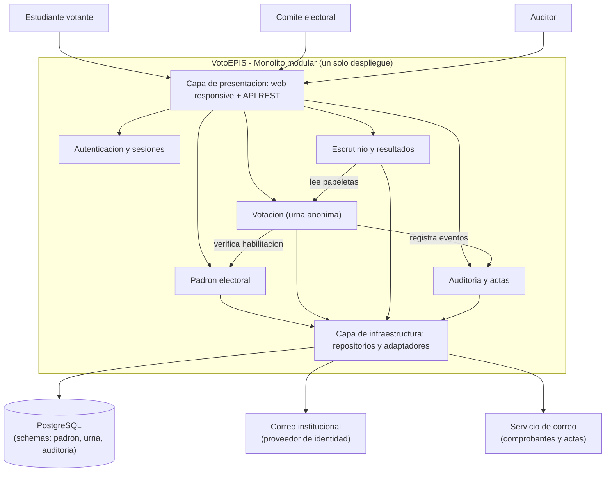

# VotoEPIS — Laboratorio 04: Fundamentos de Arquitectura de Software
**Construcción de Software · EPIS - UNSA · Semestre 2026-B**

## Integrantes y Roles
| Nombre | Rol en el laboratorio |
|---|---|
| Cuno Cahuari Armando Steven | Analista de Requisitos, Matriz y Diagramador Mermaid (E1, E2, E3, E4) |
| Quiñonez Delgado Aarón Fernando | Ingeniero de Modelado, Despliegue y Decisiones (E5, E6, E7, E8) |

## Caso VotoEPIS
Plataforma web para la elección digital de delegados estudiantiles de la Escuela Profesional de Ingeniería de Sistemas (EPIS - UNSA). Facilita la carga de padrones, sufragio seguro y anónimo, escrutinio automático y auditoría independiente mediante actas con hash criptográfico. Su atributo de calidad crítico es **Seguridad e Integridad**: garantía estricta de un solo voto por estudiante, secreto inviolable y trazabilidad verificable. El MVP debe operar en producción en 1 mes sobre un único VPS.

## Arquitectura Elegida (Monolito Modular)

## Artefactos del Repositorio
- [Drivers arquitectónicos y escenarios de calidad](docs/architecture/drivers.md)
- [Matriz de decisión ponderada](docs/architecture/matriz-decision.md)
- [Decisiones de Arquitectura (ADR)](docs/architecture/adr/)
- [Alternativa descartada en PlantUML](docs/architecture/diagramas/alternativa.puml)
- [Script de vista de despliegue](docs/architecture/diagramas/despliegue.py)
- [Bitácora crítica de uso de IA](docs/architecture/bitacora-ia.md)

## Reflexión sobre el uso de la IA (Uso Crítico)
Los asistentes de IA aceleraron significativamente la redacción de sintaxis en Diagram as Code y la generación de escenarios de prueba. No obstante, se evidenció un fuerte sesgo inicial hacia soluciones complejas (microservicios y Kubernetes), incompatibles con el plazo de 1 mes y el hardware acordado. La verificación humana contrastando documentación oficial y restricciones de presupuesto evitó sobreingeniería, demostrando que la IA funciona como herramienta de apoyo heurístico, pero la toma de decisiones arquitectónicas recae enteramente en el equipo.
