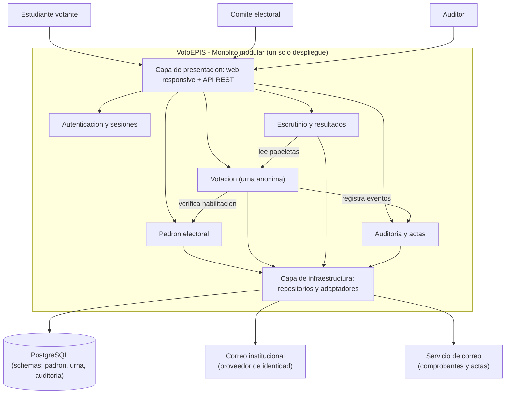
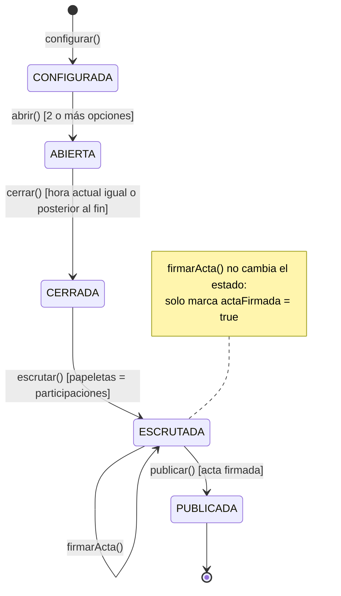
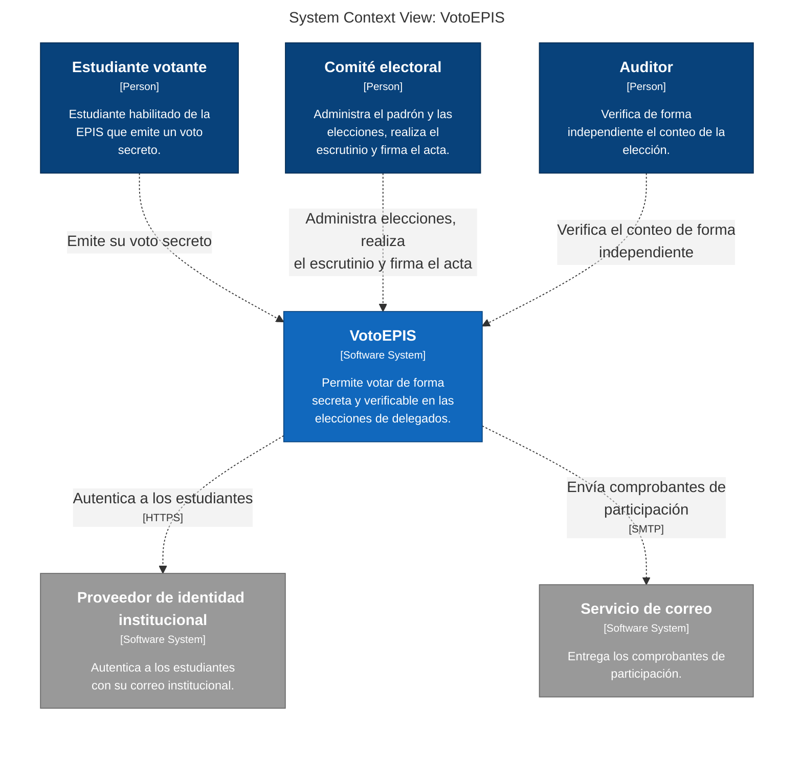

# VotoEPIS — Laboratorio 04: Fundamentos de Arquitectura de Software
**Construcción de Software · EPIS - UNSA · Semestre 2026-B**

## Integrantes y Roles
| Nombre | Rol en el laboratorio |
|---|---|
| Cuno Cahuari Armando Steven | Analista de Requisitos, Matriz y Diagramador Mermaid (E1, E2, E3, E4) |
| Quiñonez Delgado Aarón Fernando | Ingeniero de Modelado, Despliegue y Decisiones (E5, E6, E7, E8) |

## Caso VotoEPIS
Plataforma web para la elección digital de delegados estudiantiles de la Escuela Profesional de Ingeniería de Sistemas (EPIS - UNSA). Facilita la carga de padrones, sufragio seguro y anónimo, escrutinio automático y auditoría independiente mediante actas con hash criptográfico. Su atributo de calidad crítico es **Seguridad e Integridad**: garantía estricta de un solo voto por estudiante, secreto inviolable y trazabilidad verificable. El MVP debe operar en producción en 1 mes sobre un único VPS.

## Arquitectura Elegida (Monolito Modular)


## Artefactos del Repositorio
- [Drivers arquitectónicos y escenarios de calidad](docs/architecture/drivers.md)
- [Matriz de decisión ponderada](docs/architecture/matriz-decision.md)
- [Decisiones de Arquitectura (ADR)](docs/architecture/adr/)
- [Alternativa descartada en PlantUML](docs/architecture/diagramas/alternativa.puml)
- [Script de vista de despliegue](docs/architecture/diagramas/despliegue.py)
- [Bitácora crítica de uso de IA](docs/architecture/bitacora-ia.md)

## Reflexión sobre el uso de la IA (Uso Crítico)
Los asistentes de IA aceleraron significativamente la redacción de sintaxis en Diagram as Code y la generación de escenarios de prueba. No obstante, se evidenció un fuerte sesgo inicial hacia soluciones complejas (microservicios y Kubernetes), incompatibles con el plazo de 1 mes y el hardware acordado. La verificación humana contrastando documentación oficial y restricciones de presupuesto evitó sobreingeniería, demostrando que la IA funciona como herramienta de apoyo heurístico, pero la toma de decisiones arquitectónicas recae enteramente en el equipo.

## Diseño UML (Lab 05)

Diseño detallado de la historia crítica **HU-03: emitir un voto secreto**, coherente con la arquitectura de monolito modular (ADR-001) y la preservación del voto secreto (ADR-002).

### Máquina de estados de la Elección


### Índice de Artefactos de Diseño
| Entregable | Archivo de Código Fuente | Diagrama Renderizado |
|---|---|---|
| **E1: Clases de Dominio** | [`clases.puml`](docs/design/clases.puml) | [Ver Imagen](docs/design/img/clases-votacion.png) |
| **E2: Secuencia (Flujo Crítico)** | [`secuencia-emitir-voto.puml`](docs/design/secuencia-emitir-voto.puml) | [Ver Imagen](docs/design/img/secuencia-emitir-voto.png) |
| **E3: Estados de Elección** | [`estados-eleccion.mmd`](docs/design/estados-eleccion.mmd) | Renderizado en GitHub |
| **E4: Proceso de Escrutinio** | [`actividades-escrutinio-acta.puml`](docs/design/actividades-escrutinio-acta.puml) | [Ver Imagen](docs/design/img/actividades-escrutinio-acta.png) |
| **E5: Paquetes Modulares** | [`paquetes.puml`](docs/design/paquetes.puml) | [Ver Imagen](docs/design/img/paquetes.png) |
| **E6: Round-Trip Engineering** | [`round-trip.md`](docs/design/round-trip.md) | [Clases Pyreverse](docs/design/img/classes_votoepis.png) |
| **E7: Auditoría C1-C5** | [`consistencia.md`](docs/design/consistencia.md) | [Bitácora de IA](docs/design/bitacora-ia.md) |
| **Arquitectura: Nuevo ADR** | [`ADR-004`](docs/architecture/adr/004-puerto-auditoria-en-compartido.md) | — |

---

## Arquitectura C4 (Lab 06)

Modelo C4 unificado en Structurizr DSL ([`workspace.dsl`](docs/architecture/c4/workspace.dsl)), coherente con las decisiones arquitectónicas (ADR-001 a ADR-004) y el diseño detallado UML (Lab 05).

### Nivel 1: Vista de Contexto (Mermaid exportado)


### Vistas y Documentación C4
| Entregable / Vista | Fuente / Exportado | Imagen Renderizada |
|---|---|---|
| **Inventario C4** | [`inventario.md`](docs/architecture/c4/inventario.md) | — |
| **Modelo Único (DSL)** | [`workspace.dsl`](docs/architecture/c4/workspace.dsl) | — |
| **Nivel 1: Contexto** | [`structurizr-Contexto.puml`](docs/architecture/c4/export/structurizr-Contexto.puml) | [Ver PNG](docs/architecture/c4/img/structurizr-Contexto.png) |
| **Nivel 2: Contenedores** | [`structurizr-Contenedores.puml`](docs/architecture/c4/export/structurizr-Contenedores.puml) | [Ver PNG](docs/architecture/c4/img/structurizr-Contenedores.png) |
| **Nivel 3: Componentes** | [`structurizr-Componentes.puml`](docs/architecture/c4/export/structurizr-Componentes.puml) | [Ver PNG](docs/architecture/c4/img/structurizr-Componentes.png) |
| **Nivel 4: Código (Lab 05)** | [`clases.puml`](docs/design/clases.puml) | [Ver PNG](docs/design/img/clases-votacion.png) |
| **Vista Dinámica** | [`structurizr-EmitirVoto.puml`](docs/architecture/c4/export/structurizr-EmitirVoto.puml) | [Ver PNG](docs/architecture/c4/img/structurizr-EmitirVoto.png) |
| **Vista de Despliegue** | [`structurizr-Despliegue.puml`](docs/architecture/c4/export/structurizr-Despliegue.puml) | [Ver PNG](docs/architecture/c4/img/structurizr-Despliegue.png) |
| **Contexto Manual** | [`contexto-manual.puml`](docs/architecture/c4/contexto-manual.puml) | [Ver PNG](docs/architecture/c4/img/contexto-manual.png) |
| **Comparación** | [`comparacion.md`](docs/architecture/c4/comparacion.md) | — |
| **Revisión Oficial C4** | [`revision-c4.md`](docs/architecture/c4/revision-c4.md) | — |
| **Explicación No Técnica** | [`explicacion.md`](docs/architecture/c4/explicacion.md) | — |
| **Bitácora de IA (Lab 06)** | [`bitacora-ia.md`](docs/architecture/c4/bitacora-ia.md) | — |

---

## Patrones de Diseño (Lab 07)

Refactorización orientada a patrones de diseño GoF en el módulo de Votación, protegiendo el comportamiento con pruebas de caracterización y aislando el componente de IA.

### 1. Resumen de Patrones Aplicados

| Olor detectado | Patrón GoF aplicado | Principio SOLID | Archivo / Implementación |
|---|---|---|---|
| `if/elif` por medio de autenticación y acoplamiento a SDKs | **Strategy + Adapter + Factory** | Abierto/Cerrado (O), Inversión de Dependencias (D) | `src/votacion/autenticacion.py` |
| Reintentos ante fallas de red duplicados en cada medio | **Decorator** (`ConReintentos`) | Responsabilidad Única (S), Abierto/Cerrado (O) | `src/votacion/autenticacion.py` |
| Condicionales anidados sobre `eleccion.estado` | **State** (`EstadoEleccion`) | Sustitución de Liskov (L), Responsabilidad Única (S) | `src/votacion/estados.py` |
| Notificaciones y auditoría mezcladas en el servicio | **Observer** (`PublicadorEventos`) | Responsabilidad Única (S), Abierto/Cerrado (O) | `src/votacion/eventos.py` |
| Componente de IA no determinista con riesgo de alucinación | **Strategy + Decorator + Chain of Resp.** | Segregación de Interfaces (I), Responsabilidad Única (S) | `src/votacion/ia.py` |

### 2. Métricas de Impacto (Radon 6.0.1)

| Métrica | Antes (condicionales) | Después (patrones) | Impacto |
|---|:---:|:---:|---|
| Complejidad método `emitir_voto` | **19 (C)** | **3 (A)** | -84 % de rutas ciclomáticas |
| Complejidad promedio del módulo | **4.69 (A)** | **1.72 (A)** | Mayor legibilidad y testabilidad |
| Líneas de código (SLOC) | 130 | 315 | +142 % por indirección y contratos |
| Pruebas automatizadas en verde | 19 pruebas | 88 pruebas | Cobertura total de caracterización y patrones |

---

## Diseño de la Arquitectura Guiado por Atributos de Calidad (Lab 08)

[](https://github.com/SteveArms/cs-2026b-lab04--grupoXX/actions/workflows/fitness.yml)

Escalamiento del monolito modular para **25 000 votantes en 8 horas**, pico de apertura de **5 votos/s** (~20 req/s), resiliencia ante caídas del IdP institucional y **auditoría externa independiente** mediante el método Attribute-Driven Design (ADD 3.0), evaluación ATAM-lite y fitness functions continuas en CI.

### 1. Resumen Consolidado de Iteraciones ADD

| Iteración / Driver Principal | Tácticas Arquitectónicas Aplicadas | Evidencia Cuantitativa (Simulaciones `fitness/`) | ¿Cumple? | Decisión / ADR |
|---|---|---|:---:|:---:|
| **Iteración 1: Rendimiento**<br>`QA-03 (H, H)`<br>Pico de apertura: 4 500 votantes en 15 min (5 votos/s) | • Sesión firmada de 15 min (valida IdP solo en login).<br>• Comprobante por correo asíncrono (patrón transactional outbox).<br>• Caché en memoria de opciones de papeleta. | • p95 de «emitir voto» bajó de **saturación (> 16.8 s, 234 % utilización)** a **229 ms**.<br>• Utilización de CPU en el VPS: **54 %**.<br>• Capacidad máxima de la API: **9 votos/s** (margen de 1.8×). | **SÍ**<br>(p95 ≤ 2 s) | [`ADR-006`](docs/architecture/adr/006-rendimiento-pico-apertura.md)<br>[`iteracion-1.md`](docs/architecture/add/iteracion-1.md) |
| **Iteración 2: Disponibilidad**<br>`QA-04 (H, H)`<br>Caída total del IdP institucional por 30 min en hora punta | • *Circuit Breaker* sobre adaptador OIDC (corta tras 3 fallas por 30 s).<br>• *Bulkhead*: 4 workers dedicados a `/auth/*` aislados de sufragio.<br>• Mesa de contingencia presencial del comité con códigos OTP físicos (`OtpComiteSDK`). | • Solicitudes cortadas (> 30 s) cayeron de **98.5 % a 0 %**.<br>• Votantes con sesión activa mantuvieron p95 de **138 ms**.<br>• Llamadas al IdP caído reducidas de 1 411 a **59** (≤ 1 c/ 30 s).<br>• Votantes sin sufragar al cierre bajaron de 25 % a **0.6 %**. | **SÍ**<br>(p95 ≤ 2 s,<br>< 5 % afectados) | [`ADR-007`](docs/architecture/adr/007-disponibilidad-falla-idp.md)<br>[`iteracion-2.md`](docs/architecture/add/iteracion-2.md) |
| **Iteración 3: Auditoría y Secreto**<br>`QA-02 (H, M)` y `QA-06 (H, M)`<br>Auditor externo post-elección y protección de identidad | • Cadena criptográfica de hashes SHA-256 (`RegistroAuditoriaEncadenado`).<br>• Anclaje periódico externo cada 15 min al comité/auditores.<br>• Exportación mezclada de papeletas con orden aleatorio criptográfico. | • Detección del **100 %** de modificaciones, borrados y reordenamientos en eventos anclados.<br>• Detección del **92 %** de reescrituras completas de BD.<br>• Verificación completa de 27 000 eventos en **< 0.1 s**.<br>• Tasa de adivinación del voto reducida a **37 %** (azar puro; tasa base 46 %). | **SÍ**<br>(100 % detección,<br>tiempo ≤ 10 min,<br>acierto ≤ tasa base) | [`ADR-008`](docs/architecture/adr/008-auditoria-secreto-anclaje.md)<br>[`iteracion-3.md`](docs/architecture/add/iteracion-3.md) |

---

### 2. Fitness Functions de Arquitectura (Compuertas de Calidad)

Implementadas como compuertas automatizadas en la integración continua ([`.github/workflows/fitness.yml`](.github/workflows/fitness.yml)) para evitar la degradación arquitectónica ante futuros cambios:

#### A. Fitness Functions Estructurales ([`.importlinter`](.importlinter))
Verifican el acoplamiento y las fronteras de los módulos hexagonales en tiempo de compilación/linting:
- **`FF-01 (Capas del monolito modular)`**: Prohíbe ciclos y dependencias inversas; flujo unidireccional estricto: `votacion` $\to$ `padron` $\to$ `compartido`.
- **`FF-02 (Aislamiento de SDKs externos)`**: Protege el núcleo del dominio, los patrones GoF, padrón y compartido impidiendo la importación directa de `votacion.externos`.
- **`FF-03 (Aislamiento de versión ingenua)`**: Garantiza que el código en producción no dependa de implementaciones previas sin patrones (`votacion.antes`).

#### B. Fitness Functions de Calidad ([`tests/test_fitness.py`](tests/test_fitness.py))
Convierten los escenarios de calidad y decisiones de ADD en pruebas automatizadas ejecutables sobre los modelos estocásticos y el código real:
- **Rendimiento (`QA-03`):**
  - `test_ff04_rendimiento_pico_de_apertura`: Valida p95 ≤ 2 000 ms y utilización de CPU ≤ 70 % a 5 votos/s.
  - `test_ff04b_el_correo_del_comprobante_sigue_siendo_asincrono`: Garantiza que el correo nunca vuelva a ser síncrono.
- **Disponibilidad (`QA-04`):**
  - `test_ff05_idp_caido_no_afecta_a_votantes_con_sesion`: 0 % de solicitudes cortadas y p95 ≤ 2 s durante caída del IdP.
  - `test_ff05b_breaker_protege_al_idp_caido`: Valida límite de llamadas del *Circuit Breaker* hacia el servicio caído.
  - `test_ff06_bulkhead_aisla_emitir_de_un_idp_lento`: Protege el flujo de emisión ante latencias de hasta 1 s en el IdP.
- **Auditabilidad y Secreto (`QA-02`, `QA-06`):**
  - `test_ff07_auditor_detecta_toda_alteracion_de_eventos_anclados`: 100 % de detección ante ataques de manipulación o reescritura en eventos anclados cada 15 min.
  - `test_ff07b_verificacion_del_auditor_en_menos_de_10_min`: Verificación del auditor externo en menos de 600 segundos.
  - `test_ff07c_eventos_de_auditoria_sin_datos_del_voto`: Valida que los eventos de auditoría no contengan votos, correos ni datos del votante.
  - `test_ff08_exportacion_mezclada_no_revela_el_voto`: Confirma que el acierto por posición no supera la tasa base.
  - `test_ff09_la_papeleta_no_referencia_al_votante`: Valida sobre el **código real** de `src/` que `Papeleta` no expone ningún dato identificador del estudiante (ADR-002).

---

### 3. Ejecución Local de Fitness Functions

```bash
# Activar entorno virtual
source .venv/bin/activate

# 1. Ejecutar fitness functions estructurales (import-linter)
PYTHONPATH=src lint-imports

# 2. Ejecutar fitness functions de calidad (ADD)
pytest -v tests/test_fitness.py

# 3. Ejecutar suite completa (fitness + caracterización + patrones GoF)
pytest
```

---

### 4. Índice de Artefactos de Arquitectura (Lab 08)
- [Árbol de Utilidad y Escenarios de Calidad](docs/architecture/utilidad/escenarios.md)
- [Iteración 1 ADD: Rendimiento (QA-03)](docs/architecture/add/iteracion-1.md)
- [Iteración 2 ADD: Disponibilidad (QA-04)](docs/architecture/add/iteracion-2.md)
- [Iteración 3 ADD: Auditoría y Secreto (QA-02, QA-06)](docs/architecture/add/iteracion-3.md)
- [Evaluación ATAM-lite y Matriz de Riesgos](docs/architecture/atam-lite.md) ([Ver Gráfico](docs/architecture/img/riesgos.png))
- [Vista C4 Contenedores v2 tras ADD (E6)](docs/architecture/c4/export/structurizr-Contenedores-v2.puml) ([Ver PNG](docs/architecture/c4/img/structurizr-Contenedores-v2.png))
- [Bitácora de Uso Crítico de IA (Lab 08)](docs/architecture/bitacora-ia.md)
- [Documento de Fitness Functions](docs/architecture/fitness-functions.md)
- [ADR-006: Rendimiento en Pico de Apertura](docs/architecture/adr/006-rendimiento-pico-apertura.md)
- [ADR-007: Disponibilidad ante Caída del IdP](docs/architecture/adr/007-disponibilidad-falla-idp.md)
- [ADR-008: Auditoría Externa y Preservación del Secreto](docs/architecture/adr/008-auditoria-secreto-anclaje.md)

