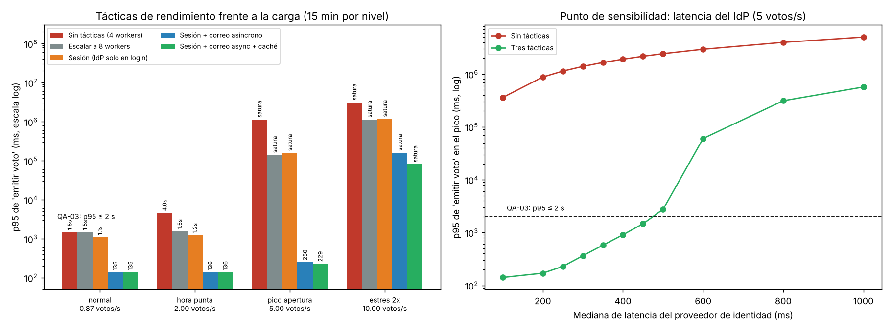

# Iteración 1 de ADD: rendimiento en el pico de apertura (QA-03)

## 1. Entradas revisadas
| Insumo | Origen | Qué aporta |
|---|---|---|
| Drivers y restricciones | `drivers.md` (Lab 04) | 1 mes, mismo equipo, 1 VPS, Ley 29733 |
| Estilo | ADR-001 | Monolito modular Django: no se cambia sin evidencia |
| Integridad y secreto | ADR-002 | Participación y papeleta en **la misma transacción**. Ninguna táctica puede romper esto |
| Modelo C4 | `c4/workspace.dsl` (Lab 06) | Contenedores web, API y PostgreSQL |
| Patrones | Lab 07 | Puerto `AutenticadorVotante`, Observer `NotificadorComprobante` (correo **síncrono** dentro de `emitir_voto`) |
| Escenarios | `utilidad/escenarios.md` (E1) | QA-03 (H,H) |

## 2. Objetivo de la iteración
Cumplir **QA-03**: con 4 500 votantes en los primeros 15 min (5 votos/s, 20 solicitudes/s), el **p95 de "emitir voto" debe ser ≤ 2 s**.

## 3. Elemento que se refina
El contenedor **API (monolito modular Django)**, en particular el flujo de autenticación y la notificación del comprobante.

## 4. Conceptos de diseño evaluados (Prompt IA 2)
| # | Concepto | Propuesta de la IA | Qué mejora | Qué empeora | Decisión del equipo |
|---|---|---|---|---|---|
| 1 | Migrar a microservicios + Kubernetes | «Escalabilidad horizontal para 25 000 usuarios» | Capacidad ilimitada en teoría | Viola R-01, R-02 y R-03, y amplía la superficie de ataque | **Rechazada.** La simulación muestra que el monolito con 3 tácticas soporta el pico con utilización del 54 % |
| 2 | Escalar de 4 a 8 workers | Táctica «aumentar recursos» | Capacidad | Más RAM en el VPS | **No basta sola**: con 8 workers el pico **sigue saturado** (117 %). Queda como **plan B** para el margen 2× |
| 3 | Sesión firmada de 15 min: el IdP se consulta **solo en el login** | Táctica «reducir demanda» | Quita unos 250 ms de cada solicitud | Si se revoca a un votante, el cambio tarda hasta 15 min (trade-off con seguridad) | **Aceptada.** El padrón se congela al abrir la elección (State, Lab 07), así que la revocación a mitad de jornada no ocurre |
| 4 | **Correo del comprobante asíncrono**: tabla outbox en PostgreSQL + worker | Táctica «concurrencia / diferir trabajo» | Quita unos 400 ms de SMTP a «emitir» | El correo llega segundos después (la pantalla muestra el comprobante al instante); suma un proceso **Worker** | **Aceptada.** Es la táctica de mayor efecto. El outbox va en la misma transacción del voto, así que no se pierde |
| 5 | Caché de la papeleta (opciones) | Táctica «caché» | 40 → 8 ms en «ver papeleta» | Invalidación | **Aceptada (margen).** Riesgo nulo: State **prohíbe** cambiar opciones con la elección ABIERTA |
| 6 | Cola asíncrona de **votos** («aceptar ahora, registrar después») | «Desacoplar la escritura» | p95 muy bajo | Se confirma un voto que aún no es durable. Rompe el ADR-002 y QA-01 | **Rechazada:** lo que se vuelve asíncrono es el **correo**, nunca el voto |

## 5. Evidencia: simulación M/G/c (`fitness/rendimiento.py`)
Se modela la API como una cola con 4 workers síncronos y llegadas de Poisson, durante 15 min por nivel de carga. Para regenerar: `python -m fitness.rendimiento`.

**p95 de «emitir voto»** (en ms; *satura* = utilización ≥ 100 % y la cola crece sin límite):

| Variante | Normal 0,87 votos/s | Hora punta 2 votos/s | **Pico 5 votos/s (QA-03)** | Estrés 10 votos/s |
|---|---|---|---|---|
| Sin tácticas (4 workers) | 1 470 | 4 558 ❌ | satura (234 %) ❌ | satura (466 %) |
| Escalar a 8 workers | 1 467 | 1 533 | satura (117 %) ❌ | satura (233 %) |
| Sesión (IdP solo en login) | 1 104 | 1 210 | satura (119 %) ❌ | satura (239 %) |
| Sesión + correo asíncrono | 135 | 136 | **250** ✅ (59 %) | satura (119 %) |
| **Sesión + correo asíncrono + caché** | **135** | **136** | **229 ✅ (54 %)** | satura (109 %) |
| Las 3 tácticas + 8 workers (plan B) | — | — | 139 | **152** ✅ (55 %) |

**Lectura:**
- Sin tácticas, la API ya falla en la **hora punta** (4,6 s) y colapsa en el pico. El problema no es la CPU sino las **esperas a servicios externos** (IdP y SMTP), que bloquean un worker síncrono.
- Por eso escalar a 8 workers no basta: duplica el costo y sigue saturado.
- Con las 3 tácticas el pico queda en **229 ms**, con utilización del **54 %**, y la capacidad máxima es de unos **9 votos/s** (en 8 votos/s, p95 = 928 ms; en 9 votos/s, 5,5 s). El margen sobre el pico es de **1,8×**. Si el comité espera más, se activa el plan B (8 workers), que da 152 ms con 10 votos/s.

### Punto de sensibilidad descubierto
Con las 3 tácticas, el p95 depende **fuertemente** de la latencia del IdP, porque el login todavía bloquea un worker:

| Mediana de latencia del IdP | 100 ms | 250 ms | 350 ms | 400 ms | 450 ms | **500 ms** | 600 ms |
|---|---|---|---|---|---|---|---|
| p95 de «emitir voto» en el pico | 141 | 229 | 577 | 908 | 1 469 | **2 745 ❌** | 60 s ❌ |

Si el proveedor institucional se pone **lento** (no caído) el día de la elección, QA-03 deja de cumplirse desde unos 500 ms. Esto **se pasa a la iteración 2** (disponibilidad del IdP) y a la evaluación ATAM-lite (E3).

### Supuestos de la simulación (🔶 sin mediciones reales)
| Supuesto | Valor | Cómo podría invalidar la decisión |
|---|---|---|
| Latencia del IdP | mediana 250 ms, lognormal σ = 0,6 | Si es ≥ 500 ms, QA-03 falla (ver tabla de sensibilidad) |
| Envío SMTP síncrono | mediana 400 ms | Si fuera rápido, la táctica 4 aportaría menos, pero la decisión no cambia |
| Tiempo propio de cada solicitud | login 30, papeleta 40 (8 con caché), emitir 60, comprobante 20 ms | Medir con el prototipo (reto opcional A, k6/Locust) |
| Workers | 4 síncronos (gunicorn) en un VPS de 2 vCPU | Con menos vCPU, la capacidad baja |
| Solicitudes independientes (Poisson) | 4 por votante, tipo al azar | Las llegadas reales a ráfagas empeoran el p95 |
| Pico | 18 % del padrón en 15 min | Si el comité escalona el correo por facultad, el pico baja |

## 6. Instanciación y vistas
- **API:** middleware de sesión firmada de 15 min. El adaptador OIDC se usa solo en el callback de login.
- **Nuevo contenedor Worker** (proceso `manage.py procesar_outbox`, sin Celery ni Redis): lee la tabla `notificaciones.outbox` y envía los comprobantes. Atiende [QA-03].
- **PostgreSQL:** tabla `outbox`, escrita en la misma transacción del voto (no se pierde si se cae el worker).
- `NotificadorComprobante` (Observer, Lab 07) deja de llamar a SMTP y escribe en el outbox, sin tocar `ServicioVotacion`.
- Se reflejará en `c4/workspace.dsl` y en el **ADR-006** (E6).

## 7. Análisis: ¿se cumple el escenario?
**Sí:** p95 = **229 ms ≤ 2 000 ms** en el pico, con 54 % de utilización. Sin tácticas era 4,6 s ya en hora punta.
**Trade-offs aceptados:** revocación diferida 15 min; comprobante por correo con unos segundos de retraso; un proceso más (Worker).
**Riesgo nuevo:** sensibilidad a la latencia del IdP (≥ 500 ms rompe QA-03). Se aborda en la iteración 2.

## Lista de verificación (E2)
- [x] Objetivo = escenario (H,H) de mayor prioridad (QA-03).
- [x] 6 conceptos evaluados (≥ 3); 2 rechazados con argumentos (microservicios y cola de votos).
- [x] Evidencia **antes y después** con la misma medida del escenario (p95 de «emitir voto» en ms).
- [x] Supuestos de la simulación escritos.
