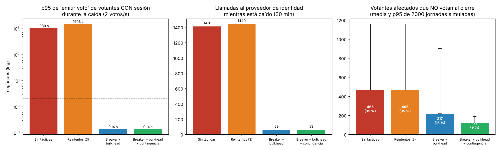

# Iteración 2 de ADD: disponibilidad ante la caída del proveedor de identidad (QA-04)

## 1. Entradas
- **QA-04 (H,H):** el IdP institucional no responde durante 30 min en hora punta (2 votos/s).
  - Los votantes **con sesión** deben mantener un p95 de «emitir» ≤ 2 s, con 0 solicitudes cortadas.
  - Como máximo un **5 %** de los votantes afectados puede quedarse sin votar al cierre.
  - El IdP caído debe recibir **≤ 1 llamada cada 30 s**.
- **Riesgo crítico R1** de la autoevaluación ATAM-lite (E3), P = 3 e I = 5. Esta iteración lo mitiga.
- **Punto de sensibilidad S1** (iteración 1): un IdP **lento** (≥ 500 ms) también rompe QA-03.
- ADR-003: ya preveía un «plan de contingencia acordado con el comité».
- Lab 07: el puerto `AutenticadorVotante` y el Decorator `ConReintentos` permiten agregar tácticas **sin tocar** `ServicioVotacion`.

## 2. Elemento que se refina
El **módulo Autenticación** (adaptador OIDC) y el **despliegue de la API**, que se reparte en dos grupos de workers.

## 3. Conceptos de diseño evaluados
| # | Concepto | Origen | Mejora | Empeora | Decisión |
|---|---|---|---|---|---|
| 1 | Solo **reintentos** (`ConReintentos`, 3 intentos de 5 s) | Lab 07 | Tolera fallas transitorias | Con el IdP caído, cada login bloquea un worker **15 s**: castiga a todos | **Insuficiente sola** (ver evidencia). Se mantiene **detrás** del breaker para timeouts aislados |
| 2 | **Circuit breaker** sobre el adaptador OIDC (Decorator) | Catálogo de Bass, «prevenir fallas» | Falla rápida (5 ms) con un aviso claro; protege al IdP mientras se recupera | Durante unos 30 s después de que vuelve el IdP aún se rechazan logins (semiabierto) | **Aceptada** |
| 3 | **Bulkhead**: grupo de 4 workers solo para `/auth/*` (Nginx enruta por ruta) | Catálogo, «gestionar recursos» | Un IdP **lento o caído** ya no frena «emitir voto»; elimina S1 | +4 procesos de gunicorn en el VPS (≈ 400 MB de RAM 🔶) | **Aceptada** |
| 4 | OTP enviado al **correo institucional** como contingencia | Propuesta de la IA | Fácil de implementar | **Falla de modo común:** si el correo y el IdP son del mismo proveedor (🔶 verificar con la OTI), caen juntos | **Rechazada como única contingencia** |
| 5 | **Mesa de contingencia del comité**: verifica el carné y entrega un código de un solo uso (`OtpComiteSDK`, Lab 07). El comité además puede **extender el cierre 30 min** | ADR-003 y equipo | Independiente del IdP y del correo | Capacidad limitada (3 personas ≈ 135 votantes cada 30 min); requiere un procedimiento | **Aceptada** |
| 6 | Segundo proveedor de identidad (p. ej., cuentas Google + Microsoft) | Propuesta de la IA | Redundancia real | La identidad debe ser **institucional** (R-05); no cabe en 1 mes | **Rechazada** |

Esquema del Decorator. Se apila como los del Lab 07, así que la fábrica devuelve `ConCircuitBreaker(ConReintentos(OidcAdapter(idp)))`:

```python
class ConCircuitBreaker(AutenticadorVotante):
    """Si el IdP falla 3 veces seguidas, responde 'no disponible' sin llamarlo durante 30 s."""
    def __init__(self, interno, umbral=3, espera_s=30, reloj=time.monotonic): ...
    def autenticar(self, correo_esperado, credencial):
        if self.estado == "ABIERTO":
            raise ProveedorNoDisponible("Usa la mesa de contingencia o vuelve más tarde")
        try:
            r = self._interno.autenticar(correo_esperado, credencial)
        except TimeoutError:
            self._registrar_falla(); raise
        self._fallas, self._abierto_desde = 0, None
        return r
```

## 4. Evidencia: `fitness/disponibilidad.py`
Para regenerar: `python -m fitness.disponibilidad`. Parte de la configuración de la iteración 1 (sesión, correo asíncrono y caché).

### Parte A: cola M/G/c con la caída inyectada (1 h de hora punta, 2 votos/s; el IdP cae de 00:15 a 00:45)
| Variante | p95 de «emitir» de votantes **con sesión** | Solicitudes de «emitir» cortadas (> 30 s) | p95 de la respuesta al login | Llamadas al IdP caído | Tiempo hasta normalizarse cuando vuelve el IdP |
|---|---|---|---|---|---|
| Sin tácticas (timeout de 5 s) | **1 030 s** ❌ | 98,5 % | 1 029 s | 1 411 | 305 s |
| Reintentos (3 × 5 s) | **1 503 s** ❌ | 99,6 % | 1 488 s | 1 440 | 449 s |
| **Breaker + bulkhead** | **138 ms** ✅ | **0 %** ✅ | 5 ms (falla rápida con aviso) | **59** ✅ (≈ 1 cada 30 s) | **0 s** |
| Breaker + bulkhead + contingencia | 138 ms ✅ | 0 % ✅ | 5 ms | 59 ✅ | 0 s |

**Lectura:**
- Sin tácticas, los logins que esperan el timeout ocupan los 4 workers, y los votantes que **ya tenían sesión** tampoco pueden votar (falla en cascada).
- Los **reintentos lo empeoran**: cada login bloquea un worker 15 s en vez de 5 s.
- El bulkhead aísla «emitir voto» y el breaker deja de golpear al IdP. Son 59 llamadas: las que abren el circuito al inicio y, después, una sola prueba cada 30 s mientras el IdP sigue caído.

### Parte A': IdP **lento** (no caído) en el pico de 5 votos/s. Resuelve S1 de la iteración 1
| Mediana de latencia del IdP | 250 ms | 500 ms | 750 ms | 1 000 ms | 2 000 ms |
|---|---|---|---|---|---|
| p95 de «emitir», sin bulkhead | 229 ms | **2 745 ms ❌** | 249 s ❌ | 570 s ❌ | 1 851 s ❌ |
| p95 de «emitir», con bulkhead | **139 ms** | **139 ms** | **139 ms** | **139 ms** | **139 ms** |
| p95 del login, con bulkhead (4 workers) | 726 ms | 2 304 ms | 143 s | 463 s | — |

Con un IdP lento el breaker **no se abre**, porque el IdP responde. Por eso hace falta el bulkhead. Quien ya votó o tiene sesión no se entera. Con un IdP de ≥ 750 ms el **login** se satura, y ese límite queda como sensibilidad residual (nuevo **S3**).

### Parte B: Monte Carlo de 2 000 jornadas de 8 h (la caída de 30 min empieza a una hora al azar)
| Variante | Afectados (media) | Afectados que **no votan** (media) | p95 entre jornadas | % de los afectados |
|---|---|---|---|---|
| Sin tácticas | 1 329 | 465 | 1 157 | 35,0 % ❌ |
| Reintentos | 1 329 | 465 | 1 157 | 35,0 % ❌ |
| Breaker + bulkhead (aviso claro) | 1 329 | 217 | 902 | 16,4 % ❌ |
| **+ mesa de contingencia + extensión de 30 min** | 1 347 | **122** | **187** | **9,0 %** ⚠️ |



### Supuestos (🔶)
| Supuesto | Valor | Cómo podría invalidar la decisión |
|---|---|---|
| Timeout del cliente HTTP hacia el IdP | 5 s | Con uno mayor, la cascada sin bulkhead es peor |
| Votante que ve un error genérico y vuelve más tarde | 70 % | **Punto de sensibilidad del resultado de la parte B** |
| Votante que ve el aviso claro y el anuncio oficial y vuelve | 90 % | Ídem: el 9 % residual sale casi entero de aquí |
| Mesa de contingencia | 3 personas, 40 s por votante | Con más personas baja el residual |
| Perfil de llegadas | 18 % en los primeros 15 min; picos a las 12:00 y antes del cierre | Si la caída coincide con la apertura, hay más afectados (de ahí el p95 de 1 157) |
| Correo institucional del mismo proveedor que el IdP | Probable | Si son independientes, el OTP por correo sería una contingencia válida y escalable |

## 5. Instanciación y vistas
- **Autenticación:** `ConCircuitBreaker(ConReintentos(OidcAdapter))`, registrado en `fabrica_por_defecto`. Además, `MesaContingenciaAdapter(OtpComiteSDK)` se registra como medio `"COMITE"`. **0 cambios** en `ServicioVotacion` (QA-07 se sigue cumpliendo).
- **API:** dos grupos de gunicorn, `votacion` (4) y `auth` (4). Nginx enruta `/auth/` a `auth`.
- **Elección (State):** nueva transición `Abierta.extender_cierre(nuevo_fin)`, solo para el comité y solo si `nuevo_fin > fin`. Se registra en auditoría.
- Se reflejará en `workspace.dsl` y en el **ADR-007** (E6).

## 6. Análisis: ¿se cumple QA-04?
- **Votantes con sesión: sí.** p95 = 138 ms y 0 % de solicitudes cortadas (antes: 1 030 s y 98,5 %).
- **Llamadas al IdP caído: sí.** 59 en 30 min, es decir, una cada 30 s aproximadamente. Antes eran 1 411.
- **≤ 5 % de afectados sin votar: no se cumple del todo (9,0 %).** El residual depende del comportamiento humano (si vuelven o no), que la arquitectura no controla.
  - El riesgo R1 baja de **P3 · I5** a **P3 · I3**: la caída ya no tumba a todos, solo a quienes aún no habían entrado.
  - Opciones para llegar al 5 %: más personas en la mesa (con 6 personas, unos 270 votantes cada 30 min) o confirmar con la OTI que el correo es independiente para usar OTP por correo.
  - Esto se discute con el comité y se registra como **riesgo aceptado** en `atam-lite.md` (E7).
- **Bonus:** el bulkhead elimina el punto de sensibilidad S1 de la iteración 1.
