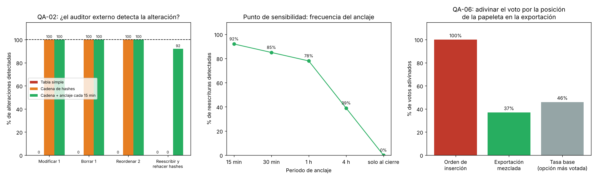

# Iteración 3 de ADD: auditoría externa y secreto en la exportación (QA-02 y QA-06)

## 1. Entradas
- **QA-02 (H,M):** el auditor externo debe detectar el **100 %** de las alteraciones del registro de auditoría (modificar, borrar, reordenar o reescribir eventos ya anclados) y verificarlo en ≤ 10 min.
- **QA-06 (H,M):** quien conozca el orden en que votaron no debe acertar los votos mejor que la **tasa base** (decir siempre la opción más votada).
- **Riesgos R2 y R3** de la autoevaluación ATAM-lite (E3).
- ADR-002: papeleta sin referencia al votante; exportación mezclada con su SHA-256 en el acta. ADR-004: el puerto `RegistroAuditoria` vive en `compartido` y lo implementa el módulo Auditoría.
- Atacante que se modela: **un administrador con acceso total a la BD** durante o después de la jornada. Es el caso que más preocupa a un auditor externo.

## 2. Elemento que se refina
El **módulo Auditoría** (implementación de `RegistroAuditoria`), el **Worker** de la iteración 1, que ahora también entrega las anclas, y la **exportación de la urna** (módulo Escrutinio).

## 3. Conceptos de diseño evaluados
| # | Concepto | Origen | Mejora | Empeora | Decisión |
|---|---|---|---|---|---|
| 1 | Blockchain o ledger distribuido | Propuesta de la IA (otra vez; ya se había rechazado en el Lab 04) | Inmutabilidad distribuida | Varios nodos, consenso, otra tecnología: viola R-01, R-02 y R-03 | **Rechazada.** El anclaje externo (concepto 4) da la propiedad que hace falta |
| 2 | Tabla **append-only**: el rol de la app no tiene `UPDATE` ni `DELETE`, y un trigger los rechaza | Táctica «limitar acceso» | Evita errores y ataques desde la app | Un superusuario de PostgreSQL lo puede saltar | **Aceptada**, pero **no basta**: no detecta nada |
| 3 | **Cadena de hashes**: `hash = SHA-256(hash_anterior ‖ seq ‖ t ‖ tipo ‖ eleccion_id)` | Táctica «detectar ataques» | Detecta modificar, borrar y reordenar | Serializa la escritura del registro (retiene la cabeza de la cadena) | **Aceptada** |
| 4 | **Anclaje externo**: el Worker entrega el hash de cabeza al auditor cada **15 min** y lo publica en el portal del comité; el acta lleva el hash final | Equipo | Detecta también la **reescritura completa** de la cadena, imposible de ver con el concepto 3 solo | Si el canal hacia el auditor se cae, no hay ancla en esa ventana | **Aceptada** |
| 5 | Firma digital de cada evento con la clave del servidor | Propuesta de la IA | No repudio | La clave estaría en el mismo VPS: el administrador atacante también podría firmar. Además, gestión de claves | **Rechazada.** No protege contra el atacante modelado |
| 6 | **Exportación mezclada** de papeletas (orden aleatorio) + SHA-256 del archivo en el acta | ADR-002 (ahora medido) | Rompe el vínculo entre la posición y el voto | Ninguno relevante | **Aceptada** |

## 4. Evidencia: prototipo `fitness/auditoria.py`
Se construye el registro de una jornada (25 000 votos + 2 000 rechazos = **27 000 eventos**, sin opción ni correo) y se lo ataca **100 veces por celda**, a una hora y en una posición al azar. Para regenerar: `python -m fitness.auditoria` (tarda unos 3 min).

### ¿El auditor externo detecta la alteración? (QA-02)
| Variante | Modificar 1 evento | Borrar 1 | Reordenar 2 | Reescribir y rehacer todos los hashes |
|---|---|---|---|---|
| Tabla simple (hoy) | 0 % ❌ | 0 % ❌ | 0 % ❌ | 0 % ❌ |
| Cadena de hashes | 100 % | 100 % | 100 % | **0 %** ❌ |
| **Cadena + anclaje cada 15 min** | **100 %** | **100 %** | **100 %** | **92 %**, y **100 %** de los eventos ya anclados ✅ |

### Punto de sensibilidad: frecuencia del anclaje (reescritura completa)
| Periodo | 15 min | 30 min | 1 h | 4 h | Solo al cierre |
|---|---|---|---|---|---|
| Reescrituras detectadas | **92 %** | 85 % | 78 % | 39 % | 0 % |

El 8 % que no se detecta con 15 min son alteraciones de eventos de **los últimos minutos antes del siguiente anclaje**. Ese es el riesgo residual, y su tamaño lo fija la frecuencia.

### Costo
- 27 000 eventos encadenados a **1–3 µs por evento**. La verificación completa por el auditor tarda **menos de 0,1 s** (entre 0,04 y 0,07 s en tres corridas) (prototipo en Python; con la exportación desde PostgreSQL se esperan segundos), muy por debajo de los 10 min de QA-02.
- **Trade-off con el rendimiento:** si la transacción del voto retiene la cabeza de la cadena unos 60 ms (🔶), en el pico (5 votos/s) la utilización de ese candado es del **30 %**, con una capacidad de unos **16,7 votos/s**. Como la API llega a unos 9 votos/s (iteración 1), el candado **no** es el cuello de botella. Plan B si una fitness function lo detecta: encadenar en el Worker a partir del outbox (sin candado en el voto; la cadena va unos segundos atrasada).

### ¿Se puede deducir el voto por la posición en la exportación? (QA-06)
| Exportación | Votos acertados por quien conoce el orden de votación |
|---|---|
| En orden de inserción | **100 %** ❌ |
| **Mezclada** | **37 %** ✅ (azar: Σ pᵢ² = 0,46² + 0,38² + 0,10² + 0,06² = 0,37) |
| Tasa base (decir siempre «Lista A») | 46 % |

### Supuestos (🔶)
- Distribución de votos: Lista A 46 %, Lista B 38 %, blanco 10 %, nulo 6 %. Solo afecta el valor de la tasa base.
- El auditor externo guarda las anclas fuera del VPS (su correo o su propio repositorio).
- El candado retiene la cabeza unos 60 ms (el mismo tiempo propio de «emitir» de la iteración 1).

## 5. Instanciación y vistas
- **Auditoría:** `RegistroAuditoriaEncadenado`, que implementa el puerto del ADR-004. Tabla `auditoria.evento(seq, t, tipo, eleccion_id, hash)` append-only (permisos + trigger).
- **Worker:** cada 15 min envía `(seq, hash)` al auditor externo y lo publica en el portal del comité. Al cierre, el hash final va al **acta**.
- **Escrutinio:** la exportación de papeletas sale `ORDER BY random()` y su SHA-256 va al acta (ADR-002).
- **Auditor externo:** nuevo actor y sistema externo en el C4. Se reflejará en `workspace.dsl` y en el **ADR-008** (E6).

## 6. Análisis: ¿se cumplen los escenarios?
- **QA-02: sí.** Se detecta el 100 % de las alteraciones de eventos ya anclados y la verificación se mide en segundos. Antes se detectaba el 0 % de todo.
- **QA-06: sí, para la exportación.** El acierto es del 37 %, por debajo de la tasa base del 46 %.
- **Riesgo residual (se pasa a E7):**
  1. Alteraciones de los ≤ 15 min aún no anclados (8 %).
  2. **Dentro de la BD**, el orden físico de las filas, los WAL y los respaldos sí conservan el orden de inserción. Un DBA podría usarlo (el ADR-002 ya lo reconoce). Para 1 mes se mitiga **con procedimiento**: nadie con rol de superusuario durante la jornada, accesos registrados, y reescribir la tabla en orden aleatorio y purgar los WAL tras el escrutinio.
