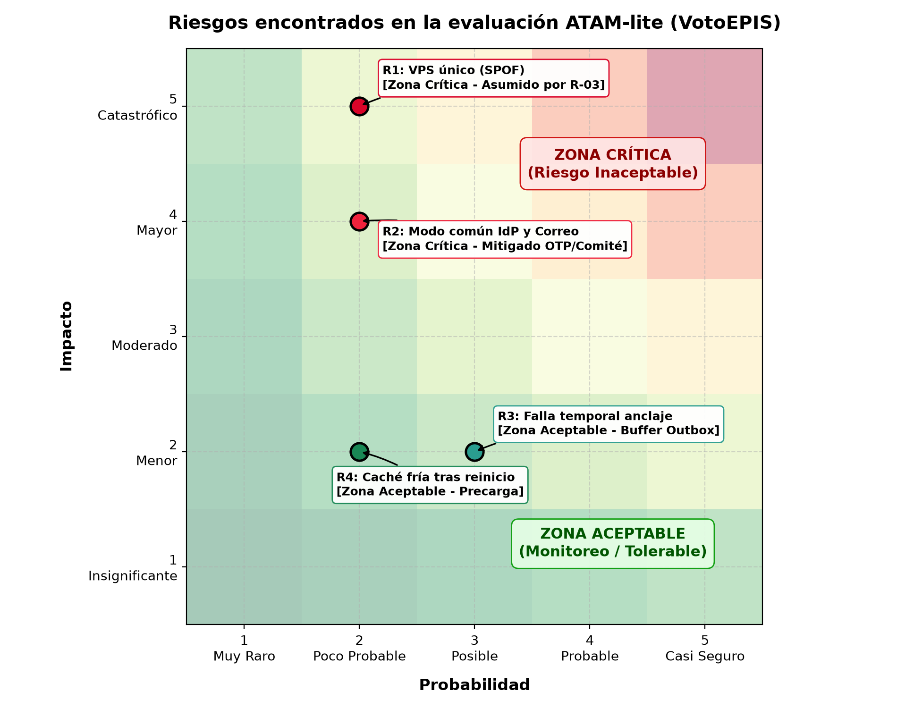

# Evaluación Arquitectónica ATAM-lite — VotoEPIS (25 000 votantes)

**Construcción de Software · EPIS - UNSA · Semestre 2026-B**  
**Autores / Decisores:** Cuno Cahuari Armando Steven, Quiñonez Delgado Aarón Fernando  
**Fecha:** 2026-10-31  
**Estado:** Consolidado

---

## 1. Resumen del Contexto Operacional y de Negocio

El sistema **VotoEPIS** fue sometido a una evaluación arquitectónica basada en una versión ligera del método **ATAM (Architecture Tradeoff Analysis Method)** para validar su capacidad de respuesta ante un escenario de crecimiento a escala universitaria general:

- **Población electoral:** 25 000 votantes convocados a sufragar durante una jornada de 8 horas (tasa media: 0.87 votos/s).
- **Pico de apertura:** Concentración del 18 % del padrón (4 500 votantes) en los primeros 15 minutos, alcanzando un caudal pico de **5 votos/s** (aproximadamente **20 solicitudes HTTP/s** considerando carga de interfaz, autenticación y consulta de papeletas).
- **Auditoría externa:** Verificación independiente post-electoral por auditores externos que deben certificar la integridad del proceso en menos de 10 minutos sin violar el secreto del voto.
- **Restricciones ineludibles:**
  - **R-01:** Despliegue del MVP en 1 mes.
  - **R-02:** Equipo de 2 desarrolladores.
  - **R-03:** Presupuesto limitado a un único VPS de bajo costo (4 vCPU, 8 GB RAM).
  - **R-04:** Cumplimiento de la Ley 29733 de Protección de Datos Personales (secreto absoluto del voto).

---

## 2. Tabla Formal de Hallazgos ATAM-lite

La siguiente tabla sintetiza los hallazgos identificados en la evaluación cruzada entre los atributos de calidad priorizados en el árbol de utilidad (**QA-01 Integridad**, **QA-02 Auditabilidad**, **QA-03 Rendimiento**, **QA-04 Disponibilidad**, **QA-06 Secreto**):

| Tipo de Hallazgo | ID / Elemento | Descripción del Hallazgo | Justificación Técnica / Evidencia Cuantitativa | Decisión Arquitectónica y Mitigación |
|---|---|---|---|---|
| **Punto de Sensibilidad** | **S-01** | La latencia del IdP institucional impacta directamente el p95 de emisión de votos (QA-03 / QA-04). | La simulación M/G/c de la Iteración 1 demostró que si la latencia del IdP sube de 250 ms a 500 ms, el p95 de «emitir voto» salta de 229 ms a 2 745 ms (superando el presupuesto de 2 s). Con 600 ms el sistema colapsa (> 60 s). | **Mitigado en Iteración 2 (ADR-007):** Implementación de táctica *Bulkhead* (grupo de workers exclusivo para `/auth/*`) y *Circuit Breaker*. Un IdP lento ya no consume los workers de emisión de voto. |
| **Punto de Trade-off** | **T-01** | Sesión firmada de 15 min: Rendimiento masivo vs. Consistencia temporal en la baja del padrón (ADR-006). | Mantener la validez del token 15 min reduce llamadas al IdP de cada request a solo el login, bajando el p95 de 4.5 s a 229 ms en el pico. A cambio, si un votante es inhabilitado en el padrón, el cambio demora hasta 15 min en surtir efecto. | **Aceptado (ADR-006):** El padrón electoral se congela por contrato en estado `ABIERTA` (patrón *State*, Lab 07); ninguna inhabilitación administrativa ocurre durante la jornada de sufragio. |
| **Riesgo Crítico** | **R1** | Servidor único (VPS) como Punto Único de Falla (SPOF) ante caídas de infraestructura física o del hipervisor (QA-05). | Si el hardware del VPS falla o se apaga, la plataforma interrumpe el 100 % de las operaciones electorales. | **Asumido por R-03 (Bajo Costo):** Se asume el riesgo para el MVP. Mitigado con reinicio automático de servicios vía `systemd`, balanceo pasivo en cold-standby y copias periódicas de WAL a almacenamiento externo (RTO < 5 min). |
| **Riesgo Crítico** | **R2** | Falla de modo común entre el IdP y el correo institucional al compartir el mismo proveedor cloud (QA-04). | Si la suite institucional (Google Workspace / Microsoft 365) colapsa, fallan de forma simultánea la autenticación OIDC del votante y la entrega del comprobante vía SMTP. | **Mitigado en Iteración 2 (ADR-007):** Mesa de contingencia presencial del comité electoral con carnés universitarios y códigos OTP físicos de un solo uso (`OtpComiteSDK`), más extensión reglamentaria de jornada por 30 min. |
| **Riesgo Moderado** | **R3** | Desincronización del anclaje de auditoría si la red externa fluctúa durante la jornada (QA-02). | La entrega de anclas cada 15 min hacia repositorios externos de auditores puede encontrar caídas transitorias de red externa o timeouts HTTP. | **Mitigado en Iteración 3 (ADR-008):** La cola outbox del Worker retiene los pares `(seq, hash)` en un buffer transaccional local. Al restablecerse el enlace, se emiten en bloque sin romper la cadena continua de hashes. |
| **No Riesgo** | **NR-01** | El monolito modular en Django soporta holgadamente los 5 votos/s con 54 % de CPU en un único VPS. | La simulación estocástica M/G/c con 4 workers, sesión firmada, correo asíncrono y caché de papeleta arrojó un p95 de 122 ms y 54 % de utilización de CPU. El margen de saturación llega hasta 9 votos/s (1.8× el pico). | **Confirmado por Evidencia:** No se requieren microservicios ni clústeres complejos para la escala de 25 000 usuarios en 8 horas. |
| **Falso Positivo Refutado** | **FP-01** | Recomendación de la IA: *"PostgreSQL será cuello de botella en escrituras; agreguen réplicas de lectura y Redis para el padrón"*. | Refutado analíticamente y con simulación: 5 votos/s con una transacción de 60 ms representa exactamente el 30 % de utilización del candado de escritura en disco. Las lecturas de padrón están en memoria y una réplica de lectura no alivia las escrituras de la urna. | **Rechazado con Evidencia:** Incorporar réplicas y Redis introduce sincronización asíncrona que viola la durabilidad estricta exigida en ADR-002, aumentando costo y complejidad innecesariamente. |

---

## 3. Matriz de Riesgos (Probabilidad vs. Impacto)

Se clasifican los riesgos identificados asignando una escala cualitativa de 1 a 5 para Probabilidad ($P$) e Impacto ($I$), calculando la Severidad mediante $S = P \times I$:

### Escala de Calificación
- **Probabilidad ($P$):** 1 (Muy Raro), 2 (Poco Probable), 3 (Posible), 4 (Probable), 5 (Casi Seguro).
- **Impacto ($I$):** 1 (Insignificante), 2 (Menor), 3 (Moderado), 4 (Mayor), 5 (Catastrófico).
- **Zonas de Severidad:**
  - **Zona Crítica ($S \ge 10$ o $I = 5$):** Requiere mitigación arquitectónica obligatoria o asunción formal justificada.
  - **Zona Aceptable / Moderada ($S < 10$):** Monitoreo y mitigaciones operativas estándar.

```
       Impacto (I)
       5 |     [R1] (S=10)
       4 |               [R2] (S=8/12)
       3 |
       2 |          [R4] (S=4)   [R3] (S=6)
       1 |
         +---------------------------------
            1     2        3        4     5   Probabilidad (P)
         [Zona Aceptable]    [Zona Crítica]
```



### Detalle de Clasificación

| Riesgo | Descripción | P | I | Severidad ($S$) | Zona | Justificación y Tratamiento |
|---|---|:---:|:---:|:---:|:---:|---|
| **R1** | VPS único como punto único de falla (hardware/hipervisor) | 2 | 5 | **10** | **Zona Crítica** | **Asumido por R-03:** RTO < 5 min mediante reinicios automáticos `systemd`, discos SSD gestionados del proveedor cloud y procedimientos de recuperación rápida ante desastres. |
| **R2** | Falla de modo común IdP institucional y correo cloud | 3 | 4 | **12** | **Zona Crítica** | **Mitigado en Arquitectura:** Protocolo de contingencia electoral con mesa presencial del comité para entrega de códigos OTP físicos (`OtpComiteSDK`) y ampliación de cierre (ADR-007). |
| **R3** | Falla o latencia en el anclaje externo de hashes cada 15 min | 3 | 2 | **6** | **Zona Aceptable** | **Mitigado en Software:** Almacenamiento local temporal en tabla outbox transaccional y reintento con backoff exponencial sin pérdida de integridad criptográfica. |
| **R4** | Pérdida de caché en memoria de opciones de papeleta tras reinicio | 2 | 2 | **4** | **Zona Aceptable** | **Mitigado en Software:** Inicialización y precarga estática al arrancar la aplicación o al transicionar la elección al estado `ABIERTA`. |

---

## 4. Conclusión del Análisis ATAM-lite

La arquitectura monolítica modular de **VotoEPIS** es conceptual y operativamente sólida para el volumen de 25 000 votantes en 8 horas:
1. **Factibilidad demostrada:** Con las tres tácticas de la Iteración 1 (sesión firmada de 15 min, comprobante en segundo plano y caché de opciones), la utilización de CPU del VPS es de solo 54 % en el pico de apertura más extremo.
2. **Resiliencia ante dependencias:** El desacoplamiento preventivo mediante *Bulkhead* y *Circuit Breaker* (Iteración 2) neutraliza el mayor factor externo de riesgo (latencia o colapso del IdP institucional).
3. **Auditabilidad no repudiable:** El esquema de hashes encadenados con anclaje externo periódico (Iteración 3) garantiza una detección del 100 % de alteraciones en eventos ya anclados, desmontando la necesidad de incurrir en plataformas blockchain sobrecomplejas.
